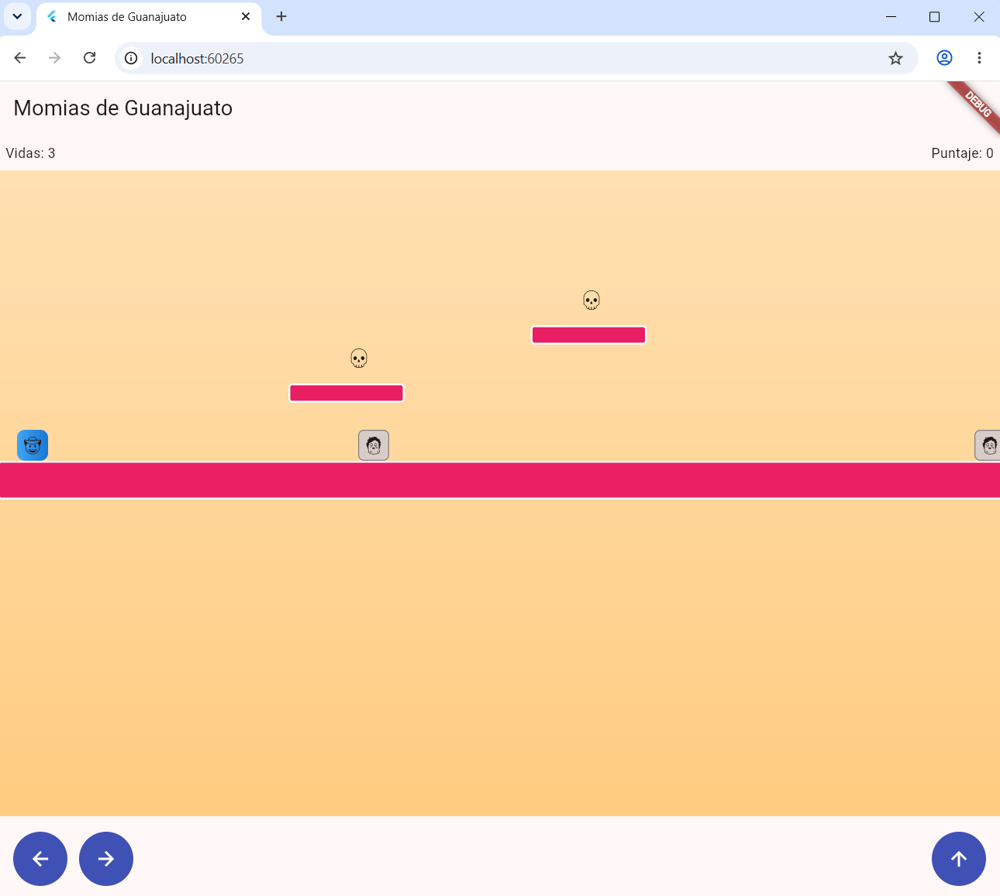

# Momias de Guanajuato: La Leyenda

Juego de plataformas en Flutter construido con **TDD** (Desarrollo Móvil Integral).
Un explorador cruza los callejones de Guanajuato saltando entre plataformas, esquivando o
derrotando momias y recolectando calaveritas hasta llegar al Callejón del Beso.



## Mecánicas

- El personaje cae por gravedad y aterriza sobre plataformas.
- Las momias patrullan entre dos límites y cambian de dirección al llegar a ellos.
- Saltar **encima** de una momia la derrota; chocar de lado quita una vida.
- Cada calaverita suma 50 puntos.
- Llegar a la meta gana la partida; quedarse sin vidas la pierde.

## Controles

| Acción    | Teclado              | Pantalla / mouse                |
|-----------|----------------------|---------------------------------|
| Izquierda | `←` o `A`            | Mantener presionado el botón ←  |
| Derecha   | `→` o `D`            | Mantener presionado el botón →  |
| Saltar    | `Espacio`, `↑` o `W` | Botón ↑                         |

## Estructura

```
lib/
  logica/            Dart puro, 100% probado con TDD
    rectangulo.dart      colisión AABB
    personaje.dart
    momia.dart           patrullaje
    calaverita.dart
    motor_fisica.dart    gravedad, salto, aterrizaje, límites, meta
    motor_combate.dart   stomp vs golpe lateral
    estado_juego.dart
    motor_juego.dart     orquesta todo en mover()
  presentation/
    juego_screen.dart    cámara, sprites y controles
  main.dart
test/
  rectangulo_test.dart
  motor_fisica_test.dart
  momia_test.dart
  motor_combate_test.dart
  motor_juego_test.dart
```

## Cómo ejecutar

```bash
flutter pub get
flutter test          # 23 pruebas en verde
flutter run -d chrome # o -d windows, o un celular/emulador
```

## Evidencia

- [Resultado de las pruebas](evidencia/resultado_pruebas.txt): 23/23 en verde
- [Análisis estático](evidencia/resultado_analisis.txt): sin problemas
- [Captura del juego](evidencia/juego_ejecutandose.png)

## Notas sobre el manual

Dos pruebas del manual fallaban por los datos de prueba, no por la lógica:

- **Combate (stomp):** con `y: 68` el pie del personaje queda exactamente en el borde superior
  de la momia (`y = 100`) y AABB no lo cuenta como intersección. Se usó `y: 70`.
- **Aterrizaje:** con `yAnterior = 85` el pie anterior (117) ya estaba debajo del borde de la
  plataforma (100), así que no "venía cayendo desde arriba". Se usó `y: 70` y `yAnterior = 65`.

Además, en la interfaz las calaveritas no pueden ser `const` (tienen estado `recolectada`) y se
agregaron controles de teclado para jugar en computadora.
